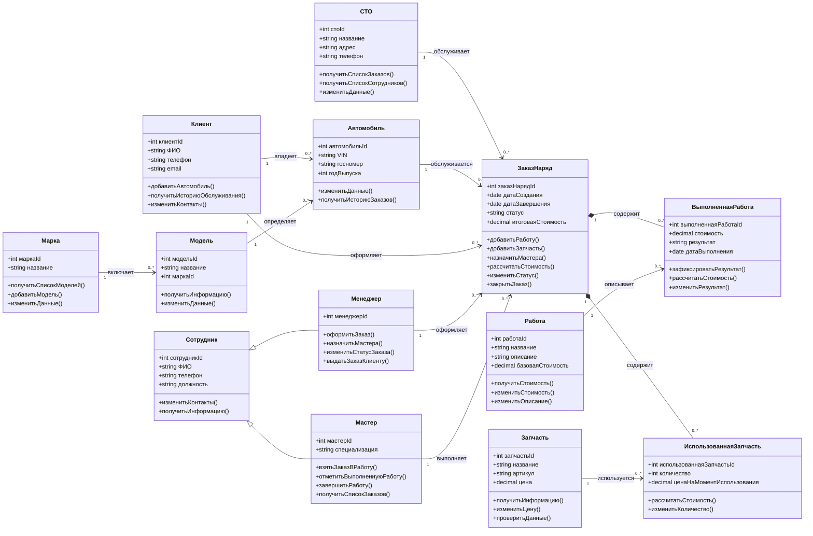

# UML-диаграмма классов информационной системы «Автосервис»

## Примечание

Диаграмма описывает основные классы, их атрибуты, операции и отношения. Состав атрибутов и методов является проектным вариантом и может уточняться при реализации системы.
